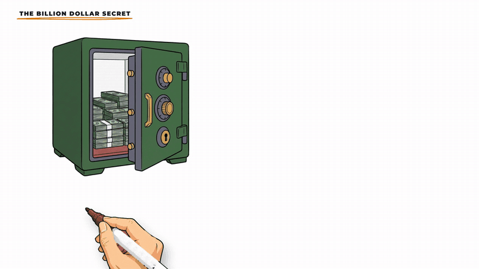
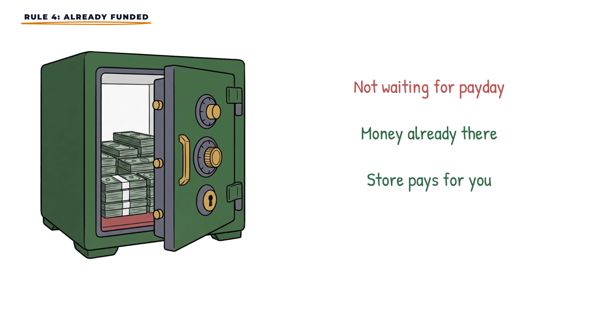
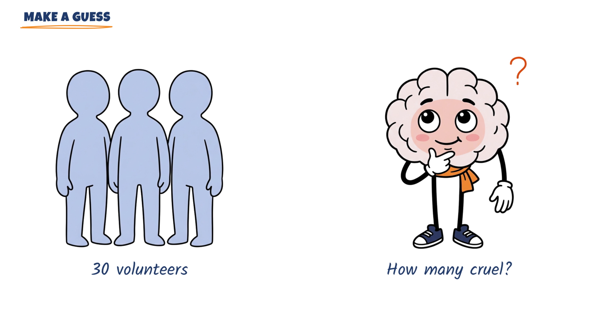
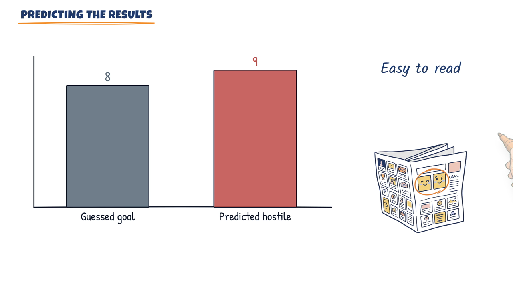
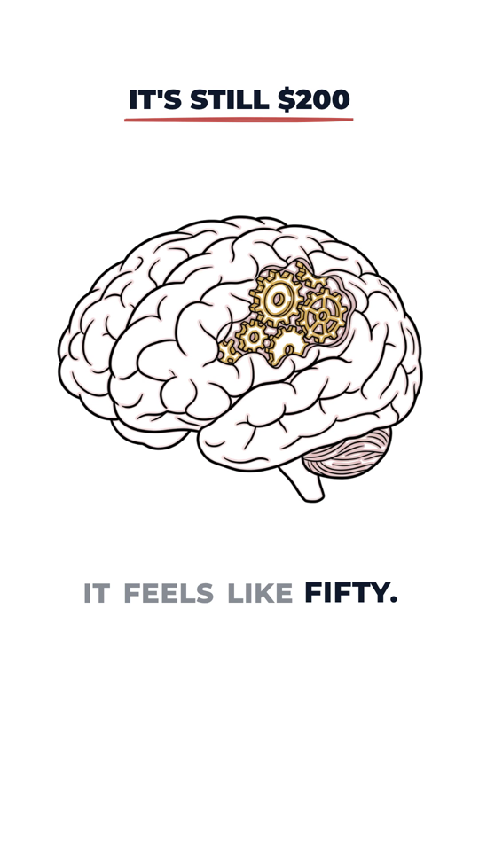
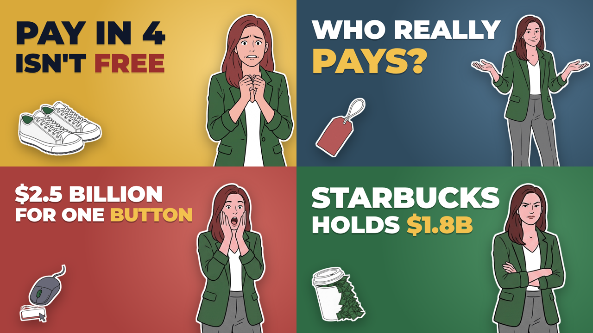
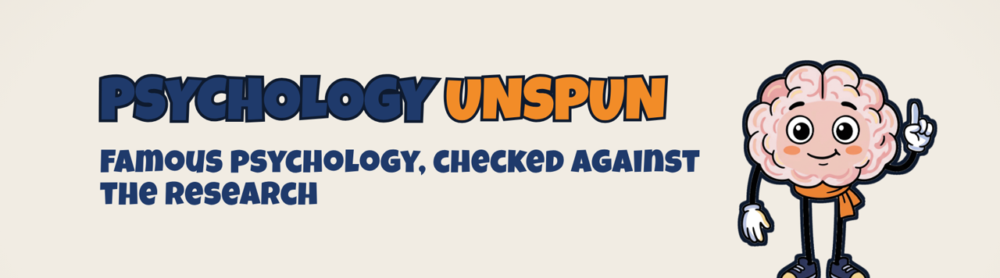
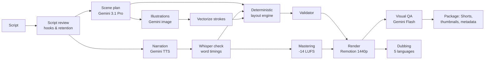

# AI Whiteboard Video Studio

**One script in, one publish-ready YouTube video out.**

This is a showcase of a production system I designed and run for two faceless YouTube channels: **Tess on Finance** (personal finance) and **Psychology Unspun** (famous psychology studies, re-checked). It turns a written script into a 1440p hand-drawn whiteboard explainer, complete with narration, music, sound effects, Shorts, thumbnails, metadata and dubbed audio tracks in five languages.



**▶ Watch a finished video:** [You Got a Raise. So Why Aren't You Richer?](https://youtu.be/ogEx7TnEPIE) (Tess on Finance)

> The source code lives in a private repository. This page explains what the system does, how it is built and the decisions behind it.
> I designed the system, made the product and quality decisions, and directed AI coding agents (Claude Code) to write and test the code.

---

## At a glance

| | |
|---|---|
| Built | Sep 21, 2026 – present (first 3 weeks) |
| Output | 6 long-form videos across 2 channels, up to 3 Shorts per video, 3–4 thumbnails per video, dubbed audio in ES / DE / PT / FR / TR |
| Code | ~6,600 lines of Python, ~4,000 lines of TypeScript/React, ~1,550 lines of tests |
| Tests | 190 automated tests (pytest + vitest), plus a scene validator that runs before every render |
| AI cost | About **$25 in total** for everything above, logged per call |
| Commits | 65+ |

---

## What comes out

| Long-form board (finance) | Long-form board (psychology) |
|---|---|
|  |  |

| Animated chart: values must appear in the script | Vertical Short with its own script |
|---|---|
|  |  |

**Thumbnails**: same mascot and layout system each time, with a different pose and background for every variant (the rules are checked in code):



**A second channel on the same engine**, with its own palette, fonts, mascot, transitions and sound set:



---

## The pipeline

A single command runs every step, cached. If nothing changed, the run finishes in about one second, and nothing is paid for twice.



`plan → images → assets → voice → master → layout → check → render → qa → package → dub`

---

## Design decisions I'm proud of

### 1. The AI decides meaning, code decides geometry and numbers
LLMs invent numbers and are unreliable at pixel layout. So the work is split. Gemini writes only a **semantic plan**: board title, template, which images, labels and the word each item should appear on.

```json
{ "header": "A COMPLICATED STORY", "start": "You've probably heard what", "template": "trio",
  "items": [
    { "image": "pm-determined",    "at": "little power",        "label": "Turn cruel",      "labelColor": "red" },
    { "image": "p-research-paper", "at": "archive is open",     "label": "The archive" },
    { "image": "p-todo-list",      "at": "three question test", "label": "3-question test", "labelColor": "green" } ] }
```

A deterministic layout engine turns that plan into coordinates, using each image's real aspect ratio, 7 templates and density rules. If the plan breaks a rule (too many items, an unknown image, a chart value that is not in the script), the errors are **fed back to the model to repair**. Chart values must appear in the script, and compound-interest curves are computed by a formula, never by the model.

### 2. Nothing is timed in frames: everything is anchored to spoken words
Every drawing is tied to a phrase (`"at": "archive is open"`). The narration is transcribed with faster-whisper and aligned back to the script (about 31 ms mean offset). Edit the script, and every animation moves with it.

### 3. Every AI output is verified before it is used
- **Narration**: every TTS paragraph is transcribed and compared word by word with the script. A single wrong word triggers a regeneration. Clipped syllables and hard cut-offs are detected and repaired.
- **Dubbing**: every number in the English must survive translation. A back-translation review grades each sentence as an *error* or a *style* note, and two independent listeners (Whisper + Gemini) must both hear a mismatch before it counts.
- **Visual QA**: after rendering, the last frame of every board goes to Gemini Flash, which looks for empty speech bubbles, half-written labels, labels that don't match their picture, overlaps and off-screen items. The first version of this prompt missed half-written labels. I rewrote it with concrete counter-examples until it caught them.

### 4. A "real pen" effect from AI images
AI-generated illustrations are reduced to centerline strokes: skeletonize, trace paths, simplify with RDP, then order them like a human would draw. Remotion reveals each image through an SVG mask built from those strokes, so the pixels stay identical to the original while the hand follows the actual lines.

### 5. Cost is a feature
Every paid call goes through a gate that is **closed by default**. The pipeline prints an estimate and stops until the run is approved, with an optional hard budget. Every response is written to a cost ledger (tokens and dollars, per job and per model), and per-model rate limits prevent quota errors. Caching means the same sentence is never voiced twice and the same audio is never transcribed twice.

### 6. Built for retention, not only for looks
- A hook library (8 long-form and 7 Shorts archetypes) scores the first 8 seconds and rejects weak openers.
- A retention checker converts the script to seconds at the narrator's pace. It flags any stretch longer than 75 seconds with no new question, open loop, payoff or viewer task. It also checks that the viewer is given a guess to make early and that every open loop is closed.
- Shorts are separate mini-scripts, not clips cut from the long video. Their first frame is pre-drawn so the scroll decision happens on a full image, and the last frames loop seamlessly back to the first.

### 7. One engine, many channels
All channel-specific choices live in a single config file: niche, mascot, voice and pace, palette, fonts, transitions, sound set, hooks, thumbnail style and disclaimers. I verified the refactor was backward compatible: the first channel's prompts stayed **byte-identical** and its frames **pixel-identical**.

---

## Real bugs and how they were caught

| Problem | How it surfaced | Fix |
|---|---|---|
| Camera zoom pushed content off-screen in 42 of 184 focus moves | Built a camera model and measured every move | "Safe camera" limits zoom so all board content stays in frame |
| A thought bubble appeared empty in a preview | Watching the 60-second preview | Bubble and its text now form one unit; added automated visual QA |
| Labels cut off mid-word as the board slid away ("Smock and ch…") | Visual QA | End-of-board hold times per element type, planned backwards as a chain |
| Dubbed audio had 14–34 pauses of 1 s+ per language (the English had none) | Silence analysis | Short sentences are slowed by up to 12% to fill the gap: pauses of 1.5 s+ dropped from 11 to 1 |
| Every Short pushed its images 206 px up into the title | Frame-by-frame review | Separate safe areas for vertical video, with tests |

---

## Stack

**Video:** Remotion 4 (React 18, TypeScript, zod), @remotion/paths, @remotion/noise, FFmpeg
**AI (Google Vertex AI):** Gemini 3.1 Pro (planning, translation, review), Gemini Flash (QA, second opinions), Gemini image generation, Gemini 2.5 Pro TTS, Lyria 3 Pro (original music)
**Speech:** faster-whisper (large-v3-turbo on GPU for verification)
**Audio:** two-pass loudnorm to -14 LUFS / -1.5 dBTP, EQ, compression, de-essing, sidechain ducking; sound effects synthesized with NumPy/SciPy (no licensed samples)
**Engineering:** Python, pytest, vitest, Git worktrees (one engine branch, one branch per channel), Claude Code with task-specific sub-agents (fact checker, long-job runner)

---

## How I work with AI

I treat AI output as a draft, not an answer. The models do the creative heavy lifting: planning scenes, drawing, voicing, translating. Deterministic code and automated checks decide whether that output is good enough to ship. When something slips through, the fix is a new check and a new test, so it can't happen again.

Every factual number in a script is checked against a primary source (SEC filings, company releases, original study archives) before production.

---

**Kerem Ceylan**
